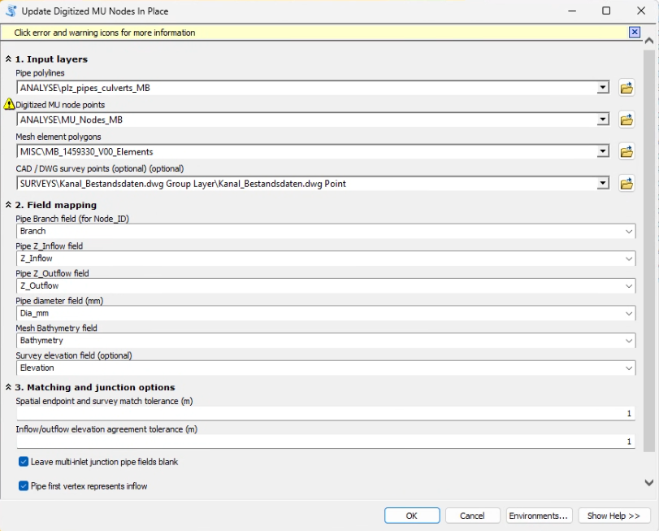
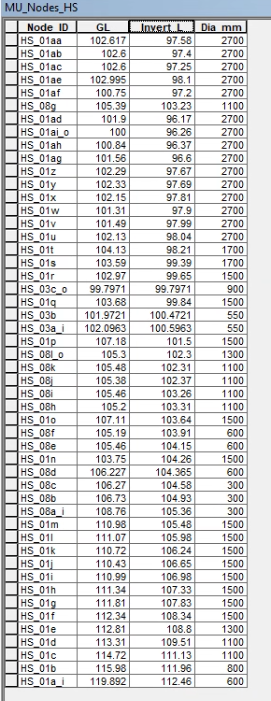

# MU Node Attribute Updater for ArcMap 10.8

A Python toolbox (`.pyt`) for filling digitized urban drainage **MU node** attributes from pipe connectivity, optional DWG survey levels, and mesh bathymetry in **ArcMap 10.8**.

It updates the selected MU node **shapefile in place** and automatically creates a timestamped backup alongside the original before editing. The node geometry and coordinate system are not changed.

## What it fills

| MU node field | Value source / rule |
| --- | --- |
| `Node_ID` | `Branch` of the incoming (previous) pipe |
| `Invert_L` | Previous pipe's `Z_Outflow`; compared with the next pipe's `Z_Inflow` when both exist |
| `Dia_mm` | Incoming pipe's diameter + **100 mm** |
| `GL` | Survey point elevation if uniquely matched and valid; otherwise the containing mesh element's `Bathymetry` |

If no DWG survey is available, valid GL values are taken from the mesh. A nonzero existing GL is retained where neither source supplies a usable value. Missing/zero survey elevations fall back to the mesh.

## Inputs and options

- **Pipe polylines** and field selectors for Branch, inflow elevation, outflow elevation, and diameter.
- **Digitized MU node points** (`.shp`) to update.
- **Mesh element polygons** and a Bathymetry field selector.
- **Optional CAD/DWG survey Point layer** and an elevation field selector.
- **Spatial endpoint and survey match tolerance** in metres (default: `2.0`).
- **Inflow/outflow elevation agreement tolerance** in metres (default: `2.0`).
- **Leave multi-inlet junction pipe fields blank** (checked by default): clears `Node_ID`, `Invert_L`, and `Dia_mm` at nodes with two or more incoming pipes. `GL` is still calculated.
- **Pipe first vertex represents inflow** (checked by default); uncheck when line digitizing direction is reversed.
- **Replace already populated pipe-derived fields** (unchecked by default).

For pipe matching, the tool projects geometries into **ETRS89 / UTM zone 32N (EPSG:25832)** in memory, allowing tolerances to be interpreted in metres. It does **not** reproject the original shapefile. Source datasets must have a defined coordinate system, and the tool requires all features to be unselected.

## Installation and use

1. Download `MU_Node_Builder_ArcMap108.pyt` from this repository.
2. In **ArcMap 10.8**, open **ArcToolbox**, right-click the toolbox area, and choose **Add Toolbox**.
3. Select the downloaded `.pyt` file and open **Update Digitized MU Nodes In Place**.
4. Choose the layers from ArcMap's Table of Contents (or browse to datasets) and verify the field dropdowns.
5. Set the tolerances and junction options, then click **OK**.
6. Review the geoprocessing messages for updated-node counts, skipped/ambiguous matches, and the backup location.

**Important:** The tool changes the selected MU node shapefile directly. Although it creates a dated backup automatically, first try it on a copy of your dataset and inspect the results carefully, especially at branching junctions.

## Files

| Path | Purpose |
| --- | --- |
| `MU_Node_Builder_ArcMap108.pyt` | ArcMap Python toolbox (Python 2.7 / ArcPy) |
| `assets/arcmap_toolbox_dialog.png` | Screenshot of configurable toolbox parameters |
| `assets/mu_nodes_attribute_table.png` | Screenshot of populated MU node attributes |
| `tests/test_mu_node_toolbox_logic.py` | Lightweight logic checks with a mocked ArcPy module |

## Testing and limits

The Python source has been syntax-checked and its core field/topology logic exercised using mocked ArcPy objects. **It has not been end-to-end tested in a live ArcMap 10.8 installation**. The screenshots are examples of the tool interface and MU node attributes, not proof of a complete automated verification.

The tool assumes pipe line direction represents inflow-to-outflow unless the relevant checkbox is disabled. If multiple survey points are within tolerance, or a mesh boundary gives conflicting bathymetry values, that source assignment is skipped to avoid guessing.
